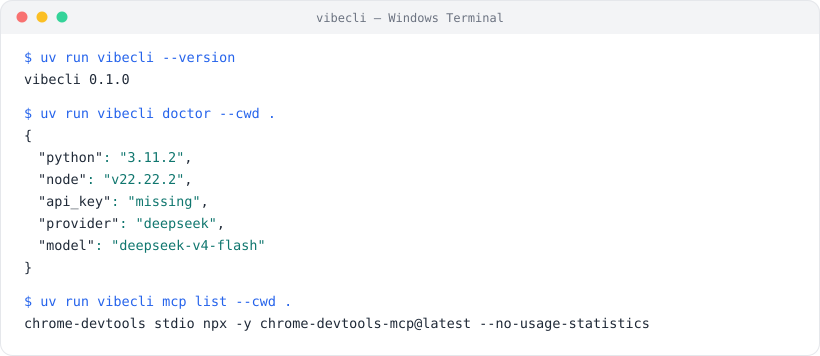

# VibeCLI (Python)

[](https://github.com/guideGX/Vibe-Cli/actions/workflows/ci.yml)


[中文](README.md) · [Architecture](docs/architecture.md) · [Parity matrix](docs/parity.md) · [Changelog](CHANGELOG.md)

A terminal AI agent CLI built for real project work: read and write files, search code, run
commands, search the web, call MCP tools, keep long-term memory, snapshot and restore the
workspace, and expose threads / turns / events / background tasks through a Runtime API.

This is the Python port of VibeCLI. It is not a demo shell: core paths are covered by tests
(97 cases, see [Development](#development)), CI runs lint + tests + smoke + build, and every
safety policy and failure path has a concrete implementation site.



## Features

- Interactive terminal agent rendered with Rich and prompt-toolkit, with a live status bar for
  model, context usage, cwd, and tool / MCP / skill counts
- Single-prompt mode (`-p`) for scripts, pipes, and automation
- OpenAI-compatible streaming LLM client, DeepSeek by default; GLM, Kimi, Step, and local
  OpenAI-compatible endpoints supported
- ReAct loop: text deltas, thinking deltas, incremental tool-call argument merging, batched tool
  execution, usage accounting
- Plan-and-Execute: a separate Planner produces a task DAG, executed in dependency batches with
  parallel siblings
- Multi-agent orchestration: Planner / Worker / Reviewer with a shared message bus, dependency
  scheduling, review rejection, and bounded retry
- 15 built-in tools across files, shell, grep, glob, memory, skills, code search, and snapshots
- Four layers of safety: path confinement, command blacklist plus destructive-command regexes,
  human-in-the-loop approval, and a redacting JSONL audit log
- MCP client over stdio and Streamable HTTP; remote tools registered as
  `mcp__<server>__<tool>`
- VibeCLI can itself act as an MCP server exposing its built-in tools (stdio / HTTP)
- Chrome DevTools MCP config helper — one command writes the JSON nobody gets right
- Skill system with built-in / user / project layers, enable/disable state, and one-shot
  `load_skill` injection
- Runtime API: threads, turns, an SSE event log, and a SQLite-backed durable task queue
- SQLite long-term memory plus a local code index (dependency-free RAG fallback)
- Automatic pre-turn / post-turn snapshots with one-command restore
- Image input from local paths, `file://`, and remote URLs, with downscaling, transparent-PNG
  flattening, and capability-based degradation
- Python syntax diagnostics after `write_file`, so the model sees its own broken output before
  the next turn

## Requirements

- Python >= 3.11
- [uv](https://docs.astral.sh/uv/) (recommended) or pip
- Optional: `rg` for faster local search
- Optional: Node.js LTS, `npm`/`npx`, and Chrome for Chrome DevTools MCP

## Install

```bash
git clone https://github.com/guideGX/Vibe-Cli.git
cd Vibe-Cli
uv sync                 # runtime dependencies
uv sync --extra dev     # plus ruff and pytest
uv run vibecli --help
```

With pip:

```bash
pip install -e .
pip install -e ".[dev]"
```

## Quick start

```bash
# 1. Provide an API key (DeepSeek is the default provider)
export VIBECLI_API_KEY="sk-..."        # macOS / Linux
set VIBECLI_API_KEY=sk-...             # Windows cmd
$env:VIBECLI_API_KEY="sk-..."          # Windows PowerShell

# 2. Check the environment
uv run vibecli doctor

# 3. Start the REPL
uv run vibecli

# 4. Or run a single prompt
uv run vibecli -p "summarize src/vibecli/agent/agent.py"
```

Real `vibecli doctor` output (stable field set, safe to paste into an issue):

```json
{
  "python": "3.11.2",
  "uv": "C:\\Users\\gx\\.local\\bin\\uv.EXE",
  "node": "v22.22.2",
  "npx": "C:\\Users\\gx\\.workbuddy\\binaries\\node\\versions\\22.22.2-6\\npx.CMD",
  "rg": "missing",
  "api_key": "missing",
  "provider": "deepseek",
  "model": "deepseek-v4-flash",
  "cwd": "C:\\Users\\gx\\Desktop\\python\\VibeCLI-Python\\VibeCLI-Python",
  "config_paths": [
    "C:\\Users\\gx\\.vibecli\\config.json",
    "C:\\Users\\gx\\Desktop\\python\\VibeCLI-Python\\VibeCLI-Python\\.vibecli\\config.json"
  ]
}
```

## CLI

| Command | Description |
| --- | --- |
| `vibecli` | Start the interactive REPL |
| `vibecli -p, --prompt <text>` | Print mode: run one prompt and exit |
| `vibecli -m, --model <name>` | Override the model |
| `vibecli --provider <name>` | Override the LLM provider |
| `vibecli --plain` | Plain-text rendering (no Rich UI) |
| `vibecli --cwd <path>` | Set the working directory |
| `vibecli --version` | Print the version |
| `vibecli doctor` | Print an environment / config report (JSON) |
| `vibecli serve --http --port <port>` | Start the Runtime API |
| `vibecli serve --api-key <key>` | Pass the Runtime API key explicitly |
| `vibecli mcp list` | List configured MCP servers |
| `vibecli mcp serve --transport stdio\|http` | Expose built-in tools as an MCP server |
| `vibecli mcp init-chrome` | Write a Chrome DevTools MCP config |

## Configuration

Config is resolved by layering, later sources overriding earlier ones:

1. Built-in defaults
2. User config — `~/.vibecli/config.json`
3. Project config — `<project>/.vibecli/config.json`
4. Project `.env`
5. CLI overrides (`--provider`, `--model`, `--plain`)
6. Process environment

The project `.env` is the shortest path:

```dotenv
VIBECLI_PROVIDER=deepseek
VIBECLI_MODEL=deepseek-v4-flash
DEEPSEEK_API_KEY=your_key_here
```

Or use the generic key:

```dotenv
VIBECLI_API_KEY=your_key_here
```

### Environment variables

| Variable | Purpose |
| --- | --- |
| `VIBECLI_API_KEY` | Generic API key |
| `VIBECLI_PROVIDER` | Provider name (`deepseek`, `glm`, `kimi`, `step`, `openai-compatible`) |
| `VIBECLI_MODEL` | Model name |
| `VIBECLI_BASE_URL` | Override the API base URL |
| `VIBECLI_MAX_TOKENS` | Max output tokens |
| `VIBECLI_TEMPERATURE` | Sampling temperature |
| `VIBECLI_RENDER_MODE` / `VIBECLI_RENDERER` | `plain` or `inline` |
| `VIBECLI_TUI` | Set to `true` to force inline rendering |
| `VIBECLI_MCP` / `VIBECLI_SKILL` / `VIBECLI_MEMORY` | `true` / `false` feature toggles |
| `VIBECLI_HITL` | Human-in-the-loop mode: `always`, `auto`, `never` |
| `VIBECLI_RUNTIME_API_KEY` | Required by `vibecli serve` |

When `VIBECLI_API_KEY` is unset, provider-specific keys are picked up instead:
`DEEPSEEK_API_KEY`, `GLM_API_KEY`, `STEP_API_KEY`, `KIMI_API_KEY`, `FREELLMAPI_API_KEY`,
`XFYUN_API_KEY`, `AGNES_API_KEY`. `<PROVIDER>_MODEL` and `<PROVIDER>_BASE_URL` work the same way.

Pointing at a local OpenAI-compatible server:

```bash
VIBECLI_PROVIDER=openai-compatible \
VIBECLI_BASE_URL=http://127.0.0.1:11434/v1 \
VIBECLI_MODEL=qwen2.5-coder \
uv run vibecli -p "explain this repo"
```

### State files

| Path | Contents |
| --- | --- |
| `~/.vibecli/config.json` | User configuration |
| `~/.vibecli/mcp.json` | User-level MCP server config |
| `~/.vibecli/memory.db` | SQLite long-term memory |
| `~/.vibecli/audit.jsonl` | JSONL audit log |
| `~/.vibecli/skills.json` | Disabled-state store for skills |
| `~/.vibecli/skills/` | User-level skills |
| `~/.vibecli/snapshots/<project-hash>/` | Project snapshots and `index.jsonl` |
| `~/.vibecli/tasks/tasks.db` | Durable background task queue |
| `~/.vibecli/runtime/runtime.db` | Runtime API threads and events |
| `~/.vibecli/history/prompt_history.txt` | REPL input history |
| `<project>/.vibecli/config.json` | Project config |
| `<project>/.vibecli/mcp.json` | Project MCP server config |
| `<project>/.vibecli/skills/` | Project skills |
| `<project>/.vibecli/code_index.sqlite3` | Local code index |

## REPL slash commands

```
/help    /exit    /clear   /context  /memory  /save    /config
/tools   /hitl    /policy  /audit    /index   /search  /plan
/team    /model   /skill   /mcp      /task    /snapshot /restore
```

| Command | Behavior |
| --- | --- |
| `/help` | Print the command list |
| `/exit` (alias `/quit`) | Quit |
| `/clear` | Clear conversation history and the screen |
| `/context` | cwd, model, context window, render mode, memory count, tool count |
| `/memory` | List memories for the current project |
| `/memory search <query>` | Term search (all terms must match) |
| `/memory clear` | Clear memories for the current project |
| `/save <fact>` | Persist one long-term memory |
| `/config` | Print the resolved config (API key redacted to `***`) |
| `/tools` | List registered tools |
| `/hitl on\|off\|always\|auto\|never` | Switch approval mode (`on` = `always`, `off` = `never`) |
| `/policy` | Print policy config (HITL mode, path guard, command blacklist, audit path) |
| `/audit [N]` | Show the last N audit records |
| `/index [path]` | Rebuild the local code index |
| `/search <query>` | Search the index (`path:line: snippet`) |
| `/plan <task>` | Run with Plan-and-Execute |
| `/team <task>` | Run with multi-agent orchestration |
| `/model [provider] [model]` | View or change the model (applies to newly created clients) |
| `/skill [list\|show <name>\|on <name>\|off <name>\|reload]` | Skill management |
| `/mcp` | Hint on exposing built-in tools as an MCP server |
| `/task [add <task>\|cancel <id>\|log <id>]` | Background task queue |
| `/snapshot [clean]` | List or clean snapshots |
| `/restore <id-or-index>` | Restore a snapshot |

## Built-in tools

| Tool | Access | Danger | Notes |
| --- | --- | --- | --- |
| `read_file` | read | safe | Numbered lines, supports `offset` / `limit` |
| `write_file` | write | medium | UTF-8 text, optional `append`, 5MB cap, diagnostics afterwards |
| `list_dir` | read | safe | List a directory |
| `glob` / `glob_files` | read | safe | Find files by pattern |
| `grep` / `grep_code` | read | safe | Text or regex search |
| `bash` / `execute_command` | write | high | Requires approval; policy-checked first |
| `web_search` | read | safe | DuckDuckGo HTML, returns title / URL / snippet |
| `web_fetch` | read | safe | Public page fetch plus text extraction; rejects loopback and private ranges |
| `save_memory` | write | medium | Write a long-term memory |
| `load_skill` | read | safe | Lazy skill load, injected once on the next model call |
| `search_code` | read | safe | Query the local code index |
| `revert_turn` | write | high | Roll back to a snapshot; requires approval |

Read-only, concurrency-safe tools run in parallel batches (4 by default); writes run strictly
sequentially in declaration order.

## MCP

Remote MCP tools are registered as:

```text
mcp__<server-name>__<tool-name>
```

Every connected server also gets four virtual tools:

```text
mcp__<server>__list_resources    mcp__<server>__read_resource
mcp__<server>__list_prompts      mcp__<server>__get_prompt
```

### Config sources

`~/.vibecli/mcp.json` (user) and `<project>/.vibecli/mcp.json` (project) are merged, project
winning on collisions. `${PROJECT_DIR}`, `${HOME}`, and environment variables are expanded.

```json
{
  "mcpServers": {
    "filesystem": {
      "type": "stdio",
      "command": "npx",
      "args": ["-y", "@modelcontextprotocol/server-filesystem", "${PROJECT_DIR}"],
      "timeout": 30
    },
    "remote": {
      "type": "streamable_http",
      "url": "https://example.com/mcp",
      "headers": { "authorization": "Bearer ${MCP_TOKEN}" }
    }
  }
}
```

With no `type`, a `url` implies `streamable_http` and everything else implies `stdio`.

### Chrome DevTools MCP

```bash
uv run vibecli mcp init-chrome                       # project scope (default)
uv run vibecli mcp init-chrome --scope user          # user scope
uv run vibecli mcp init-chrome --browser-url http://127.0.0.1:9222
uv run vibecli mcp init-chrome --headless --slim
uv run vibecli mcp list
```

It writes:

```json
{
  "mcpServers": {
    "chrome-devtools": {
      "type": "stdio",
      "command": "npx",
      "args": ["-y", "chrome-devtools-mcp@latest", "--no-usage-statistics"]
    }
  }
}
```

`--no-usage-statistics` is on by default. Real `mcp list` output:

```text
chrome-devtools	stdio	npx -y chrome-devtools-mcp@latest --no-usage-statistics
```

> Chrome DevTools MCP exposes browser pages and logged-in sessions to the agent. Do not hand it a
> Chrome profile with personal accounts or production consoles.

### Serve VibeCLI as an MCP server

```bash
uv run vibecli mcp serve --transport stdio
uv run vibecli mcp serve --transport http --port 3000
```

HTTP smoke test:

```bash
curl -sS -X POST http://127.0.0.1:3000 \
  -H 'content-type: application/json' \
  -d '{"jsonrpc":"2.0","id":1,"method":"tools/list","params":{}}'
```

## Runtime API

A small HTTP API for external systems (web backends, cron jobs, chat bots). It binds to
`127.0.0.1` only and every request needs a key via `x-api-key` or `Authorization: Bearer`.

```bash
VIBECLI_RUNTIME_API_KEY=dev-key \
uv run vibecli serve --http --port 8080
```

### Endpoints

| Method | Path | Description |
| --- | --- | --- |
| `POST` | `/v1/threads` | Create a thread, returns `{ "id": "thread_..." }` |
| `POST` | `/v1/threads/{id}/turns` | Run one turn, returns the final text |
| `GET` | `/v1/threads/{id}/events` | Replay the thread event log as SSE |
| `POST` | `/v1/tasks` | Enqueue a background task, returns `{ "id", "status": "queued" }` |
| `GET` | `/v1/tasks` | List tasks |
| `GET` | `/v1/tasks/{id}` | Fetch one task |
| `POST` | `/v1/tasks/{id}/cancel` | Cancel a task |

### curl examples

```bash
curl -sS -X POST http://127.0.0.1:8080/v1/threads -H 'x-api-key: dev-key'

curl -sS -X POST http://127.0.0.1:8080/v1/threads/<thread_id>/turns \
  -H 'content-type: application/json' \
  -H 'x-api-key: dev-key' \
  -d '{"message":"summarize this project"}'

curl -sS http://127.0.0.1:8080/v1/threads/<thread_id>/events -H 'x-api-key: dev-key'

curl -sS -X POST http://127.0.0.1:8080/v1/tasks \
  -H 'content-type: application/json' \
  -H 'x-api-key: dev-key' \
  -d '{"message":"summarize this repo in the background"}'
```

### Event types

| Event | When |
| --- | --- |
| `thread.created` | Thread creation |
| `turn.started` | A turn begins |
| `message.delta` | Model output delta |
| `tool_call` / `tool_result` | Tool invocation and result |
| `error` | Failure |
| `turn.completed` | Turn finished, carries the final text (and `done`) |

### Task queue

Background tasks live in SQLite (`~/.vibecli/tasks/tasks.db`) and survive restarts. `serve` starts
two worker threads that atomically claim queued tasks. Tasks need a working LLM key; when it is
missing the task fails with the reason recorded in its `error` field instead of being dropped.

## Image input

Reference images in a prompt with `@image:`:

```text
analyze this screenshot @image:./screenshots/page.png
explain this diagram @image:/Users/me/Desktop/diagram.png
look at this @image:file:///Users/me/Desktop/diagram.png
match this design @image:https://example.com/image.png
```

Rules:

- Local images are downscaled to a 1568px longest edge, encoded as JPEG (quality 85) into a data URL
- `RGBA` / `LA` images are flattened onto white before encoding
- Local paths must stay inside the working directory; escapes raise
- Remote URLs are passed through verbatim and not downloaded
- One prompt can interleave multiple text segments and images; they split into `text` /
  `image_url` parts in order

## Snapshots

Every agent run attempts two snapshots:

- `pre-turn` — before the turn
- `post-turn` — after the turn, including whatever the model wrote

Snapshots live in `~/.vibecli/snapshots/<project-path-hash>/`, never inside the project `.git`,
and skip `.git`, `.venv`, `node_modules`, `dist`, `build`, `target`, `__pycache__`.

```text
/snapshot                        # list the last 20 with indexes
/restore 1                       # restore by index
/restore pre-turn_20261026...    # restore by id
/snapshot clean                  # wipe snapshots
```

Restoring first creates a `pre-restore` snapshot, so a rollback is itself reversible. The model
can call `revert_turn` for the same behavior, gated behind approval.

## SDK

```python
from vibecli.sdk import create_default_engine

engine = create_default_engine(cwd=".")

result = engine.ask_complete("explain this project")
print(result.text, result.total_tokens, result.turns)

plan_result = engine.plan_complete("read the README, then summarize the layout")
team_result = engine.team_complete("have several agents review the core modules")

async for event in engine.ask("how many modules are under src/vibecli"):
    if event["type"] == "text_delta":
        print(event["text"], end="")
```

`create_default_engine` loads layered config, wires built-in tools plus MCP tools, and assembles
the system prompt. For a custom tool set, build a `ToolRegistry` and pass it to `QueryEngine`
directly — see `src/vibecli/sdk.py`.

## Web tools

- `web_search` — DuckDuckGo HTML endpoint, returns titles, URLs, and snippets. No key needed, may
  rate limit.
- `web_fetch` — fetches public HTTP/HTTPS pages and extracts text. Rejects `file://`, loopback,
  private ranges, and internal hosts to reduce SSRF risk.

For logged-in, JS-rendered, or stateful pages, use Chrome DevTools MCP rather than bending the
local tools.

## Safety

| Layer | Implementation | Blocks |
| --- | --- | --- |
| Paths | `PathGuard` | File tools escaping the workspace (`../`, absolute paths) |
| Commands | `CommandGuard` | Blacklist substrings plus destructive-command regexes (`sudo`, `rm -rf /`, `mkfs`, `dd if=/dev/zero`, fork bombs, `find /`, ...) |
| Human | `HITL` | `bash`, `revert_turn`, and other high-risk actions need a yes; non-TTY defaults to deny |
| Audit | `AuditLog` | Every non-read-only call appended to `~/.vibecli/audit.jsonl`, with `token` / `key` / `password` / `secret` / `authorization` / `bearer` fields redacted to `***` |

HITL modes:

- `always` — ask on every tool call
- `auto` (default) — ask only for tools marked `requires_approval`
- `never` — never ask (containers and sandboxes only)

## Architecture

In one line: **an event-stream ReAct loop sits between the tool executor and the LLM client,
safety wraps tool execution, and persistence (memory, index, snapshots, queue) hangs off the loop
as pluggable pieces.**

```text
CLI / REPL / Runtime API / SDK
            │
      QueryEngine  ── PromptAssembler (system prompt + project memory + skill index)
            │
      Agent / PlanExecute / Orchestrator
            │
        query()  ← ReAct loop, yields events
        ├── LlmClient (OpenAI-compatible streaming)
        └── ToolExecutor (parallel reads / serial writes)
              ├── ToolRegistry (15 built-ins + dynamic MCP tools)
              └── PathGuard / CommandGuard / HITL / AuditLog
```

See [docs/architecture.md](docs/architecture.md) for the full walkthrough: turn lifecycle, event
table, plan batching, the multi-agent message bus, and why the modules split where they do.

## Project layout

```text
src/vibecli/
  agent/         ReAct loop, Plan-and-Execute, multi-agent orchestrator, QueryEngine
  llm/           OpenAI-compatible streaming client + provider factory
  tools/         Tool base types, registry, 15 built-ins, executor
  mcp/           MCP client, server, config reader/writer (stdio / HTTP)
  lsp/           Python syntax diagnostics after writes
  plan/          Planner and task DAG models
  policy/        PathGuard, CommandGuard, AuditLog
  memory/        SQLite long-term memory
  prompt/        System-prompt assembler
  rag/           SQLite local code index
  render/        Rich and plain renderers
  runtime/       HTTP Runtime API + durable task queue
  skill/         Skill registry, lazy injection, state store
  snapshot/      pre/post-turn snapshots and restore
  image/         Image reference parsing and preprocessing
  web/           Web search and fetch helpers
  entrypoints/   CLI entrypoint and REPL
tests/           97 cases (config / policy / tools / ReAct / snapshot / Runtime API / MCP / CLI)
examples/        Config template, custom skill, prompt recipes
```

## Development

```bash
uv sync --extra dev

uv run --extra dev ruff check .
uv run --extra dev ruff format --check .
uv run --extra dev pytest        # 97 passed

uv build
uv run vibecli --help
```

Tests need no network and no API key: a `ScriptedLlm` double replays canned stream events at the
LLM boundary, and `Path.home()` is redirected into a temp directory by a fixture, so the real
`~/.vibecli` is never touched.

Common smoke checks:

```bash
uv run vibecli --version
uv run vibecli --help
uv run vibecli doctor --cwd .
uv run vibecli mcp list --cwd .
```

## Relationship to the Java / TypeScript versions

The Python port covers the public, open-protocol surface of the Java / TypeScript
implementations: CLI, REPL, ReAct, Plan-and-Execute, multi-agent, skills, SDK, tool calling, MCP,
Runtime API, memory, snapshots, web tools, and image input.

The Java version also ships a private WeChat iLink channel. This repository intentionally does not
include it: it depends on account state, QR login, and protocol credentials. Faking a "connected"
channel is worse than not having one.

See [docs/parity.md](docs/parity.md) for the item-by-item matrix.

## Design notes

**Why port this to Python at all?** The originals are Java and TypeScript. Python lowers the
barrier for reading an agent implementation end to end: type hints are enough, asyncio streaming
is ergonomic, and the whole thing can be demoed live in an interview. This is a redesign, not a
transliteration.

**Why not LangChain / LlamaIndex?** The value of this layer is precisely that the loop, tool
dispatch, and policy hooks are explicit. Wrapping a framework hides the thing worth explaining.

**Why does the Runtime API bind to `127.0.0.1` only?** It hands the caller full tool execution,
including a shell. Loopback plus an API key is the minimum honest compromise; exposing it is a
deployment concern (reverse proxy + TLS), not a code concern.

**Why are snapshots full copies?** A full copytree takes tens of milliseconds on mid-sized
projects and makes restore a pure copy with no consistency reasoning. Incremental snapshots
should be driven by real need, not imagination.

**Why is the code index SQLite `LIKE` instead of vector search?** For code, exact symbol hits beat
semantic similarity, with zero dependencies and no model downloads. The `rag/` interface leaves
room for a vector backend later.

## Roadmap

- [ ] Per-session token budget and context compression (`memory.compression_threshold` exists as a
      config slot, logic pending)
- [ ] Incremental snapshots and configurable ignore rules for large repos
- [ ] Live SSE subscription for Runtime API events (currently replay)
- [ ] Native adapters for more providers (everything goes through OpenAI-compatible today)

## License

MIT. See [LICENSE](LICENSE).
