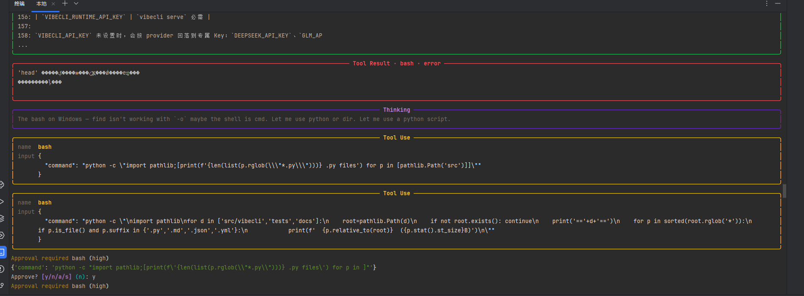

# Bug 记录 · Windows 上 `bash` 工具不可用 + 审批面板吞命令

- **发现时间**：2026-10-26
- **发现方式**：用 VibeCLI 自己在本仓库上跑任务，`bash` 工具连续报错，人工看终端输出发现异常
- **影响版本**：v0.1.0（`68fce01` 及之前所有提交）
- **修复分支**：`fix/windows-shell-and-markup`（`498a4bc` / `9caae11` / `51cc9c3`）
- **严重级别**：高。Windows 用户的核心工具链（Shell 执行 + 人工审批）同时失真，且不崩溃、只静默劣化。

---

## 一句话

代码里所有「跟宿主操作系统打交道」的边界都按 POSIX + UTF-8 + 纯文本三件事写死，在 Windows 上三件事全部不成立；而 CI 只有 `ubuntu-latest`，所以这三个假设从来没有机会被证伪。

---

## 影响面

| 受影响功能 | 表现 | 后果 |
| --- | --- | --- |
| `bash` / `execute_command` | 管道、`head`、`wc`、GNU `find` 全部不存在 | 模型无法用 Shell 完成常规任务，被迫退化成 `python -c` 一行流 |
| 同上（错误回传） | 错误信息解码成 `����` | **模型读不懂失败原因**，只能猜。这是本次最致命的一条 |
| HITL 审批面板 | 显示的命令缺一段 | 人批准的和实际执行的不是同一条命令，安全闸门失效一半 |

第三条看起来最轻，实际最重：它把「人工确认」这个安全机制变成了形式主义。

---

## 现象



三个独立异常同框出现：

1. **Tool Result · bash · error**
   `'head' 不是内部或外部命令，也不是可运行的程序或批处理文件。` —— 但中文全是乱码 `'head' �����ڲ����ⲿ���Ҳ���ǿ����еij���`

2. **Thinking（模型的自我诊断）**
   > The bash on Windows — find isn't working with `-o` maybe the shell is cmd. Let me use python or dir.

   模型已经正确猜到了「shell 是 cmd」，但它改不了运行环境，只能绕路。**诊断是对的，环境是错的。**

3. **Approval required 面板显示的命令是残的**
   ```
   {'command': 'python -c "import pathlib;[print(f'{len(list(p.rglob(\"*.py\")))}) .py files') for p in ]"'}
   ```
   模型实际发出的命令是 `... for p in [pathlib.Path('src')]]`，面板里 `[pathlib.Path('src')]` **整段消失**，只剩 `for p in ]`。

---

## 复现

环境：Windows 11 (10.0.22631)、Python 3.11.2、uv 0.12.12、`COMSPEC=C:\WINDOWS\system32\cmd.exe`。

```bash
uv run vibecli
```

```
> 数一下 src 和 tests 下有多少个 .py 文件
# 模型调用 bash: find src tests -name "*.py" | wc -l
# → 'head'/'wc' 不是内部或外部命令（且中文乱码）
```

审批面板复现（不需要真的执行）：

```python
_approval_prompt(
    {"tool_name": "bash", "danger_level": "high",
     "input": {"command": "for p in [pathlib.Path('src')]: print(p)"}},
    console, VibeCliConfig(),
)
```

旧代码打印出来的命令里，`[pathlib.Path('src')]` 消失。

---

## 根因

### 假设 1：宿主是 POSIX shell

```python
# src/vibecli/tools/builtins.py（旧）
proc = await asyncio.create_subprocess_shell(command, cwd=..., ...)
```

`create_subprocess_shell` 在 Windows 上走 `COMSPEC`，也就是 `cmd.exe`。于是：

- `head` / `wc` / `tail` / `sed` / `awk` 全部不存在
- `find` 命中的是 `C:\Windows\System32\find.exe`，参数语义和 GNU `find` 完全不同
- 单引号不是字符串定界符，`&&` 之外的分隔符行为也不一样

而 README 通篇用 bash 语法写示例、`builtins.py` 的注释也假设 POSIX，说明**作者的心理模型就是 POSIX，只是没在 Windows 上验过**。

### 假设 2：输出是 UTF-8

```python
output = (stdout + stderr).decode("utf-8", errors="replace")
```

Windows 中文环境下 `cmd.exe` 输出 GBK。实测 `ver` 的原始字节是 `0xb0 0xe6`，正是「版」字的 GBK 编码，`utf-8` 严格解码必然失败。`errors="replace"` 让这个失败**不抛异常**，于是错误信息变成一串替换字符。

这条比假设 1 更隐蔽：命令失败至少返回非零退出码，而编码错误连异常都不抛，只是把内容毁掉。

### 假设 3：`console.print` 就是打印

```python
# src/vibecli/entrypoints/repl.py（旧）
console.print(
    f"[yellow]Approval required[/yellow] {request['tool_name']} "
    f"({request['danger_level']})\n{request['input']}"
)
```

Rich 的 `console.print` 默认 `markup=True`，会把 `[...]` 当样式标签解析。而 `request['input']` 是 dict，`str()` 之后形如：

```python
{'command': '... for p in [pathlib.Path('src')]]"'}
```

`[pathlib.Path('src')]` 被当成 tag 吞掉。这条与操作系统无关，属于「把富文本接口当纯文本接口用」。

### 共同根因

三条都是同一个错误的抽象：**默认「我这套环境就是所有人那套环境」**。

真实情况是：宿主的 shell 方言、控制台编码、富文本语义都是可变的外部条件，属于必须在边界上探测或适配的东西，不能当常量。

---

## 为什么 97 个测试没拦住

| 环节 | 状态 | 结论 |
| --- | --- | --- |
| 测试用例 | 没有一条测过「非 POSIX shell 下 bash 工具的行为」，也没有一条测过 GBK 字节流解码 | 覆盖了功能，没覆盖环境 |
| CI | `runs-on: ubuntu-latest`，单平台 | 即使补了测试，也永远在假设成立的环境里跑绿 |

**测试覆盖率不等于环境覆盖率。** 这三条在本仓库自己身上演了一遍：v0.1.0 是 97 个测试全绿的版本，在 Windows 上照样不可用。

---

## 修复

### 1. Shell 改为「优先 POSIX，找不到再回退」

```python
def _resolve_posix_shell() -> str | None:
    override = os.environ.get("VIBECLI_SHELL", "").strip()
    if override:
        if override.lower() in {"", "default", "cmd", "cmd.exe", "powershell", "pwsh"}:
            return None
        if Path(override).exists() or shutil.which(override):
            return override
        return None
    if os.name != "nt":
        return None          # 非 Windows 保持 /bin/sh，行为完全不变
    return shutil.which("bash")
```

调用侧：

```python
shell = _resolve_posix_shell()
spawn = asyncio.create_subprocess_exec if shell else asyncio.create_subprocess_shell
args = [shell, "-c", command] if shell else [command]
proc = await spawn(*args, cwd=context.cwd, ...)
```

**为什么不直接 `Popen(shell=True, executable="bash")`？**
因为 Windows 上 `shell=True` 会拼成 `bash.exe /c <cmd>`，而 bash 要的是 `-c`。`/c` 是 cmd 的参数约定，bash 收到会当成路径。所以必须自己构造 argv，用 `create_subprocess_exec` 绕开 shell 包装。

**为什么这个设计不破坏其他平台？** 非 Windows 直接返回 `None`，走原来的 `/bin/sh` 路径；`VIBECLI_SHELL=cmd` 可随时退回旧行为。

### 2. 输出解码改成四级回退

```python
def _decode_output(raw: bytes) -> str:
    if not raw:
        return ""
    for encoding in ["utf-8", locale.getpreferredencoding(False), "gbk"]:
        if not encoding:
            continue
        try:
            return raw.decode(encoding)
        except (UnicodeDecodeError, LookupError):
            continue
    return raw.decode("utf-8", errors="replace")
```

顺序有讲究：先试 `utf-8`（Git Bash、现代 CLI 工具的默认），再试系统 locale（Windows 上即 cp936，覆盖 cmd 内建命令），最后兜 `replace` 保证永远有返回值、不会因为解码把工具调用打挂。

### 3. 审批面板改用 `Text` 渲染

```python
body = json.dumps(request["input"], ensure_ascii=False, indent=2)
console.print(Text.assemble((f"Approval required {request['tool_name']}", "yellow"), ...))
console.print(Text(body, style="dim"))   # Text 不过 markup 解析
```

`Text` 对象不经 markup 解析，方括号原样保留。顺手把 dict repr 换成缩进 JSON —— 原来那行 `{'command': 'python -c "...\\n..."'}` 挤成一团，人根本没法在批准前看清要跑什么。

### 4. 让模型知道自己在跟什么 shell 说话

工具描述从 `"Execute a shell command in the current workspace."` 改成显式声明走 POSIX shell、并要求写可移植命令。

原来的描述没说方言，模型只能照着 README 的 bash 示例写，撞墙后再靠运行时试错恢复。**把契约写进工具描述，是在源头消除这类试错。**

---

## 验证

修复前后在同一台机器实测：

| 命令 | 修复前 | 修复后 |
| --- | --- | --- |
| `find src tests -name "*.py" \| wc -l` | `'head' 不是内部或外部命令` | `69` |
| `ls src/vibecli \| head -5` | 报错 | 正常输出 5 项 |
| `echo 中文测试 && echo done` | `????` | `中文测试` / `done` |
| 审批面板含 `[pathlib.Path('src')]` | 方括号内容消失 | 原样保留 |

回归测试：`tests/test_windows_shell.py` 新增 5 例（GBK 解码 / UTF-8 优先 / 空字节 / `VIBECLI_SHELL=cmd` 退出 / 审批保留方括号）。

全量 **97 → 102 passed**，ruff check + format 干净。

---

## 防线（防止同类问题再存活 97 个绿测试）

```yaml
# .github/workflows/ci.yml
strategy:
  fail-fast: false
  matrix:
    os: [ubuntu-latest, windows-latest]
```

`fail-fast: false` 是刻意的：一个平台红了另一个继续跑，不掩盖信息。

这是本次唯一真正的「修复」动作 —— 前三项都只是修掉了这一次的症状。**只要 CI 不跨平台，下一个人写 `subprocess` 时还会犯同样的错。**

---

## 遗留

| 项 | 状态 |
| --- | --- |
| `cli.py::_version_of` 用 `text=True`，Windows 上按 cp936 解码 UTF-8 输出 | 未改。当前显示正常，属同类隐患 |
| MCP stdio 启动 `npx` 在 Windows 上的行为 | 实测可跑（`npx --version` → 11.19.1），未确认问题，不下结论 |
| 模型写 `find ... -o ...` 缺括号，条件松散 | 工具层无法纠正。属模型侧命令严谨性，靠工具描述提示缓解 |

---

## 可迁移的教训

1. **静默劣化比崩溃危险。** 崩溃会喊，乱码不会。模型读到 `����` 只会绕路，人只看到「这工具有点笨」。**没有错误信息的错误最贵。**
2. **`errors="replace"` 是掩盖而非修复。** 它保证了不抛异常，代价是把「我不知道这是什么编码」变成「这是一堆垃圾」。解码失败应该降级到另一种编码，而不是降级到垃圾。
3. **写配置/展示类代码时，问一句「这段内容会不会被当成语法解析」。** 富文本、模板、SQL、正则，凡是「接收字符串再解析」的接口都有这个坑。
4. **测试的环境维度要单列。** 同一个测试在 Linux 绿、在 Windows 红，说明被测代码隐含了平台契约 —— 这是设计信息，不是噪音。
5. **模型的自我诊断经常是对的，错的是它脚下的环境。** 截图里它明确说了「maybe the shell is cmd」，但还是得绕路。给人看的日志里，这类 Thinking 是定位问题的第一手线索，不该只当调试信息。
